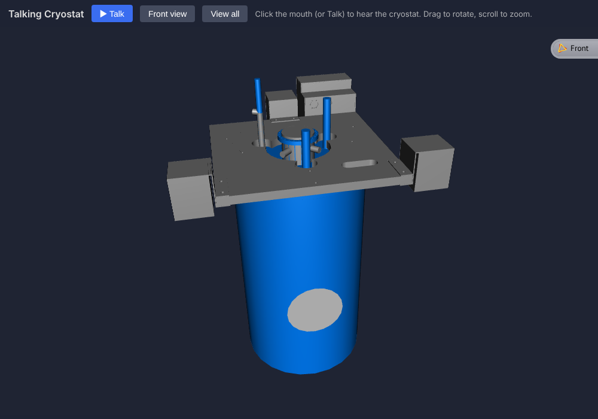

# Talking Cryostat

This is a resurrection of a 1998 demo of a portion of a scanning tunneling microscope facility. The large blue cylinder is a cryostat, which was probably 5 or 6 ft long and underground; the grey flat section was at ground level. It was originally created using CosmoWorlds.

The animated talking circle was animated via code given to me (graciously) by Mark Pesce. It simply scales the Y coordinate of the circle according to the amplitude of the sound file (me talking).

## Running it

Open `index.html` in a modern browser. It's a single standalone page: the VRML scene and the sound are embedded in it, and the [X_ITE](https://create3000.github.io/x_ite/) X3D/VRML player loads from the jsDelivr CDN, so you need an internet connection.

- **Talk**: click the circle (the mouth) or the **Talk** button to play the sound and animate the mouth.
- **Navigate**: drag to rotate freely (Examine mode, with horizon straightening turned off), and scroll to zoom.
- **Front view**: returns to the default viewpoint. **View all** fits the whole model in view.

## What changed from the 1998 files

- The three gzipped `Inline` files (cryostat, sandbox, platform) are decompressed and merged into the page, and `cryo.wav` is embedded as a base64 data URL.
- All objects sit inside a single Transform rotated 180° about Z, which is the same as 180° about X followed by 180° about Y.
- Added a NavigationInfo (EXAMINE), a default viewpoint, and a background.
- The VRML97 field `Collision.collide` was renamed to its X3D equivalent, `enabled`, because X_ITE rejects `collide`.
- The original ROUTEs (TouchSensor → TimeSensor → PositionInterpolator → mouth scale, and TouchSensor → AudioClip) are unchanged.

## Files

| Path | Description |
|---|---|
| `index.html` | Standalone, playable page (X_ITE) |
| `original/talkingstm.wrl` | Original 1998 main world (gzipped VRML 2.0, CosmoWorlds) |
| `original/cryostat2.wrl.gz`, `platform2.wrl.gz`, `sand_box2.wrl.gz` | Original inlined geometry |
| `original/cryo.wav` | Original narration (8-bit mono, 22.05 kHz) |
| `images/talkingCryostat.png` | Screenshot |
